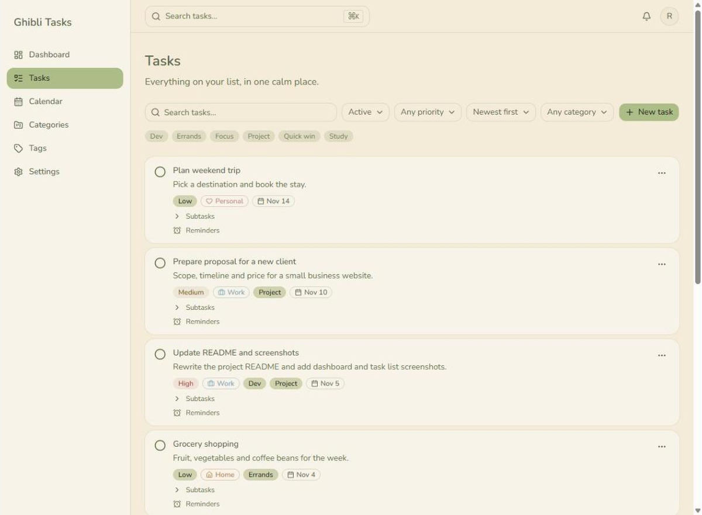
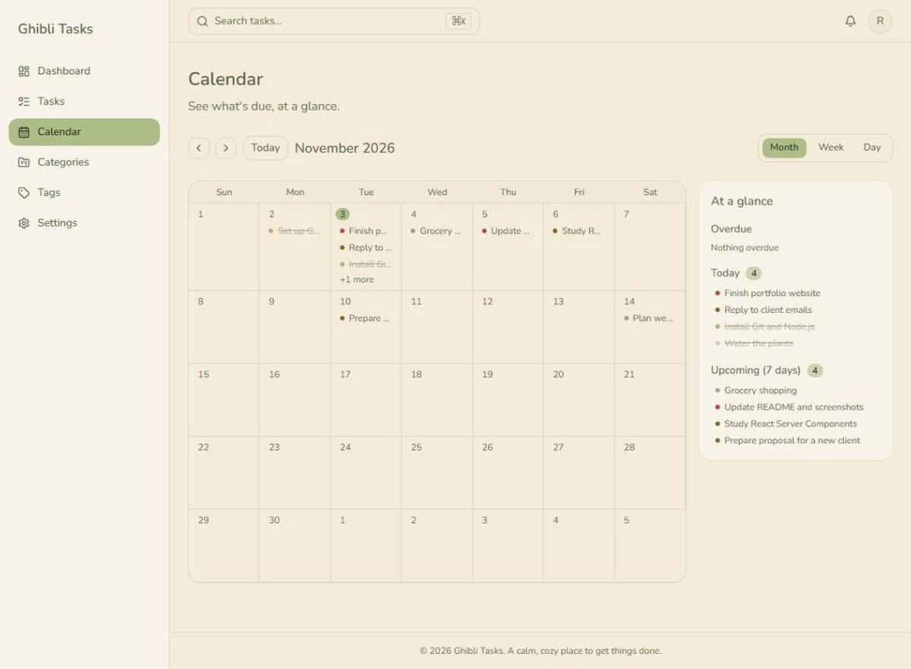
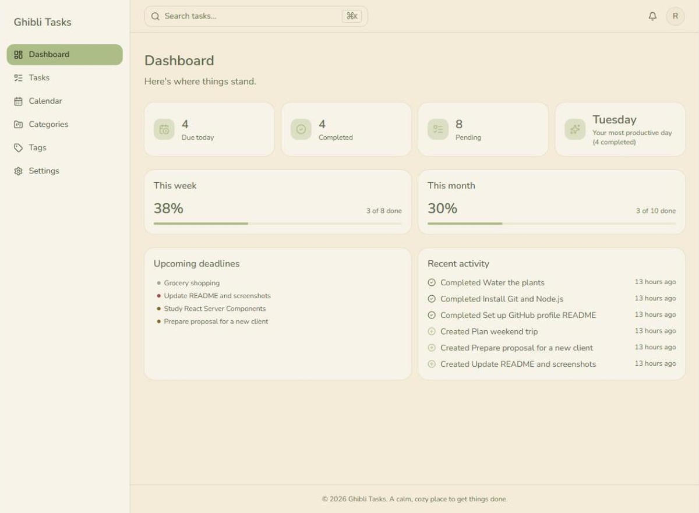

# Ghibli Tasks

A calm, cozy task manager inspired by Studio Ghibli. Plan your days with tasks, subtasks, categories, tags, reminders and a calendar, in a soft, minimal interface.

**Live demo:** https://ghibli-tasks.vercel.app (create a free account to try it)

## Features

**Tasks**
- Create, edit and delete tasks with title, description, priority (low, medium, high), due date, category and tags
- Mark tasks as complete, pin important ones and archive or restore them
- Subtasks and reminders on each task
- Search, filter by status, priority, category and tags, and sort the list



**Calendar**
- Month, week and day views with previous / next navigation



**Dashboard**
- Counters for tasks due today, completed and pending
- Progress, upcoming deadlines, recent activity and your most productive weekday



**Organization**
- Categories with custom color and icon
- Tags to group tasks across categories

**Everyday details**
- Global search with `Ctrl/⌘ + K` by title, description or tag
- Notification bell for reminders, overdue tasks and tasks due today, with per-type preferences
- Settings for profile, notification preferences and password
- Email and password accounts; sign in with email or username
- Responsive layout with mobile navigation

## Tech stack

| Area | Tools |
| --- | --- |
| Framework | Next.js 16 (App Router, Server Actions), React 19, TypeScript |
| UI | Tailwind CSS 4, shadcn/ui on Base UI, lucide-react, Sonner |
| Auth | Better Auth (email and password) |
| Database | PostgreSQL (Neon) with Prisma 7 and migrations |
| Validation | Zod |
| Testing | Vitest and Testing Library, Playwright (configured, with initial tests) |
| Tooling | ESLint, Prettier |
| Hosting | Vercel |

## Architecture

- Feature-based components in `src/components/features/`
- Business logic and database access live in `src/services/`, never inside UI components
- Pages stay thin and compose server components; mutations go through Server Actions
- All input is validated with Zod

## Getting started

Requirements: Node.js 20+ and a PostgreSQL database (a free [Neon](https://neon.tech) project works well).

```bash
git clone https://github.com/ramos-r/ghibli-tasks.git
cd ghibli-tasks
npm install
cp .env.example .env
```

Fill in `.env`:

| Variable | Description |
| --- | --- |
| `DATABASE_URL` | Pooled Postgres connection string, used at runtime |
| `DIRECT_URL` | Direct (unpooled) connection string, used by Prisma migrations |
| `BETTER_AUTH_SECRET` | Random secret, generate with `openssl rand -base64 32` |
| `BETTER_AUTH_URL` | App URL, `http://localhost:3000` in development |

Then apply the migrations and start the app:

```bash
npx prisma migrate dev
npm run dev
```

Open http://localhost:3000 and create an account.

## Scripts

| Command | What it does |
| --- | --- |
| `npm run dev` | Starts the development server |
| `npm run build` | Creates the production build |
| `npm run start` | Runs the production build |
| `npm run lint` | Runs ESLint |
| `npm run format` | Formats the code with Prettier |
| `npm test` | Runs unit and component tests (Vitest) |
| `npm run test:e2e` | Runs end-to-end tests (Playwright) |

## Roadmap

Planned, not built yet: recurring tasks, file attachments (schema is ready), dark mode, Pomodoro timer, email reminders and Google sign-in.

## Deploy

Deployed on Vercel with a Neon database. Set the same environment variables from `.env.example` in the Vercel project settings.
